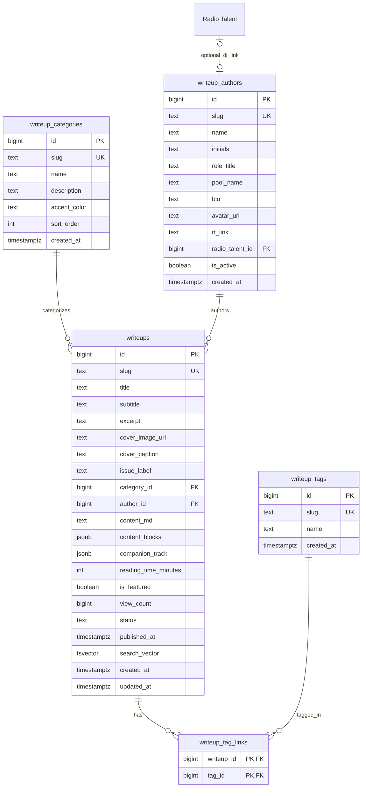

# Green Giant FM — Writeups Section Database Schema Proposal

## 1. Existing Repository & Database Audit

The repository connects to **Supabase (PostgreSQL)** via two clients:
- [lib/supabase/client.ts](../lib/supabase/client.ts) (public `anon` client)
- [lib/supabase/admin.ts](../lib/supabase/admin.ts) (server-side `service_role` client used in `actions/*.ts`)

There are currently **no local SQL migrations or Drizzle/Prisma schema files** in the repository. From inspecting all `supabaseAdmin.from(...)` calls across `actions/*.ts`, the existing Supabase database uses the following tables:

| Table | Source Action | Purpose |
| :--- | :--- | :--- |
| `"About Us EB"` | `actions/about-us.ts` | Executive Board directory (`order`, `name`, `position`, `image`, `pools`, `rt_link`) |
| `"About Us Members"` | `actions/about-us.ts` | Org pool roster members |
| `"Radio Talent"` | `actions/radio-talent.ts` | Senior DJs & trainees by `academic_year` (`id`, `name`, `rank`, `current_show`, `bio`, `stingers`, `rt_link`) |
| `"Hitlist Songs"` / `"Future Hitlist Songs"` | `actions/hitlist.ts`, `actions/admin.ts` | Active and queued Hitlist tracks (`id`, `title`, `artist`, `image_url`, `spotify_link`, `votes`, `sort_order`) |
| `"Hitlist Votes"` | `actions/hitlist.ts` | User ballots (`email`, `target_id`, `created_at`) |
| `system_metadata` | `actions/hitlist.ts`, `actions/admin.ts` | Key-value operational state (e.g., `next_reset_date`) |
| `hitlist_exports` | `actions/admin.ts` | Archived cycle CSV snapshots (`id`, `filename`, `cycle_start`, `cycle_end`, `csv_content`, `created_at`) |
| `"Finalists"` / `"DJ Hunt Votes"` | `actions/dj-hunt.ts` | DJ Hunt finalist media and user votes |

Notice two patterns in the existing codebase:
1. Older tables use quoted Title Case (`"Radio Talent"`), while newer operational tables (`system_metadata`, `hitlist_exports`) follow standard PostgreSQL lowercase `snake_case` and `bigint` numeric IDs.
2. Public pages read through Next.js Server Actions (`actions/*.ts`) backed by `supabaseAdmin` and `unstable_cache` / `revalidatePath`, while admin mutations live under `/admin/*` guarded by the JWT session middleware in [proxy.ts](../proxy.ts).

---

## 2. Proposed Entity-Relationship Diagram

---

## 3. Table Specifications

### `writeup_categories`
Stores editorial sections (`Behind the Booth`, `Music Reviews`, `Live Coverage`, `Hitlist Breakdown`, `Campus Culture`).
- `id`: `bigint generated always as identity primary key`
- `slug`: `text unique not null` (URL-safe slug matching `WriteupCategorySlug`)
- `name`: `text not null`
- `description`: `text not null default ''`
- `accent_color`: `text not null default '#569429'`
- `sort_order`: `integer not null default 0`
- `created_at`: `timestamptz not null default now()`

### `writeup_authors`
Decouples editorial bylines from `"Radio Talent"` so writers from **Digital Communications**, **Audio**, and **Publicity & Productions** can publish alongside DJs, while optionally linking to a DJ's roster profile.
- `id`: `bigint generated always as identity primary key`
- `slug`: `text unique not null`
- `name`: `text not null`
- `initials`: `text not null` (2-character fallback monogram when `avatar_url` is null)
- `role_title`: `text not null` (e.g., `Senior Editor`, `Senior DJ & Music Critic`)
- `pool_name`: `text not null` (matches GGFM pools in `constants/about-us.ts`)
- `bio`: `text not null default ''`
- `avatar_url`: `text`
- `rt_link`: `text` (optional link to `/radio-talent`)
- `radio_talent_id`: `bigint` (optional nullable reference to `"Radio Talent".id` — kept loose or `on delete set null` depending on `"Radio Talent"` PK definition)
- `is_active`: `boolean not null default true`
- `created_at`: `timestamptz not null default now()`

### `writeups`
Core article table.
- `id`: `bigint generated always as identity primary key`
- `slug`: `text unique not null`
- `title`: `text not null`
- `subtitle`: `text not null default ''`
- `excerpt`: `text not null`
- `cover_image_url`: `text not null`
- `cover_caption`: `text not null default ''`
- `issue_label`: `text not null default 'ISSUE 01'`
- `category_id`: `bigint not null references writeup_categories(id) on delete restrict`
- `author_id`: `bigint not null references writeup_authors(id) on delete restrict`
- `content_md`: `text not null default ''` (author-friendly Markdown source for `/admin/writeups`)
- `content_blocks`: `jsonb not null default '[]'::jsonb` (optional structured blocks matching `WriteupBlock[]` in `types/writeups.ts` for rich pull quotes and liner-note callouts)
- `companion_track`: `jsonb` (`{ "title": "...", "artist": "...", "spotify_url": "..." }` — pairs directly with the Spotify search helper already in `actions/admin.ts`)
- `reading_time_minutes`: `integer not null default 3 check (reading_time_minutes > 0)`
- `is_featured`: `boolean not null default false`
- `view_count`: `bigint not null default 0 check (view_count >= 0)`
- `status`: `text not null default 'draft' check (status in ('draft', 'scheduled', 'published', 'archived'))`
- `published_at`: `timestamptz`
- `search_vector`: `tsvector generated always as (...) stored` (weighted `A` on `title`, `B` on `subtitle`/`excerpt`, `C` on `content_md`)
- `created_at`: `timestamptz not null default now()`
- `updated_at`: `timestamptz not null default now()`

### `writeup_tags` & `writeup_tag_links`
Normalized many-to-many tagging so tag counts, tag filtering, and tag renames stay consistent without scanning arrays.
- `writeup_tags`: `id`, `slug` (unique), `name`, `created_at`
- `writeup_tag_links`: composite PK `(writeup_id, tag_id)` with `on delete cascade` on both foreign keys.

---

## 4. Key Architectural Decisions

1. **Lowercase `snake_case` Naming**: Aligns with newer tables (`system_metadata`, `hitlist_exports`) and avoids double-quoting identifiers in raw SQL, RPCs, and Supabase Studio.
2. **Markdown + Structured Blocks (`content_md` & `content_blocks`)**: Storing `content_md` lets GGFM's admin editor remain a lightweight Markdown/rich-text form, while `content_blocks jsonb` supports structured drop caps, pull quotes, and liner-note callouts without fragile regex parsing. Full-text search indexes `content_md` directly.
3. **Partial Unique / Fast Cover Index**: `idx_writeups_single_featured` guarantees only one `published` article can hold `is_featured = true` at a time (or indexes active featured rows cleanly), eliminating accidental double hero spreads.
4. **Generated `tsvector` + GIN Index**: Powers instant keyword search across titles, decks, excerpts, and bodies via PostgreSQL FTS without external search infrastructure.
5. **Atomic View Counter RPC**: `increment_writeup_views(target_slug text)` performs an atomic `view_count = view_count + 1` update in Postgres (`security definer`) so concurrent readers never overwrite counts, and public `anon` clients cannot arbitrarily modify article rows.
6. **Row-Level Security (RLS)**:
   - Public `anon`/`authenticated` roles can `SELECT` only `writeups` where `status = 'published' AND published_at <= now()`, plus active categories, authors, and tags.
   - All `INSERT`/`UPDATE`/`DELETE` mutations run server-side through `supabaseAdmin` (`service_role`, which bypasses RLS) inside Next.js Server Actions gated by `verifyAdminSession()`.
7. **Media Storage**: Create a public Supabase Storage bucket `writeup-media` with cache headers for cover artwork and inline photography, keeping `cover_image_url` pointed at Supabase CDN URLs.

---

## 5. Backend Integration Roadmap

1. Run [docs/sql/writeups_schema.sql](./sql/writeups_schema.sql) in the Supabase SQL Editor.
2. Create `actions/writeups.ts` mirroring `actions/radio-talent.ts`:
   - `getPublishedWriteupsAction()` (cached via `unstable_cache` with tag `'writeups'`)
   - `getWriteupBySlugAction(slug: string)`
   - `incrementWriteupViewsAction(slug: string)` (calls `supabaseAdmin.rpc("increment_writeup_views", { target_slug: slug })`)
   - Admin CRUD actions (`upsertWriteupAction`, `deleteWriteupAction`) protected by `verifyAdminSession()`, calling `revalidatePath("/writeups")`, `revalidatePath("/")`, and `revalidateTag("writeups")`.
3. Swap the static imports from `constants/writeups.ts` in [app/writeups/page.tsx](../app/writeups/page.tsx), [app/writeups/[slug]/page.tsx](../app/writeups/[slug]/page.tsx), and [app/_home-sections/writeups-section.tsx](../app/_home-sections/writeups-section.tsx) with the new server actions.
4. Add `/admin/writeups` under the existing `proxy.ts` admin guard, reusing the Spotify track picker in `actions/admin.ts` (`searchSongsAction`) to attach `companion_track` metadata in one click.
